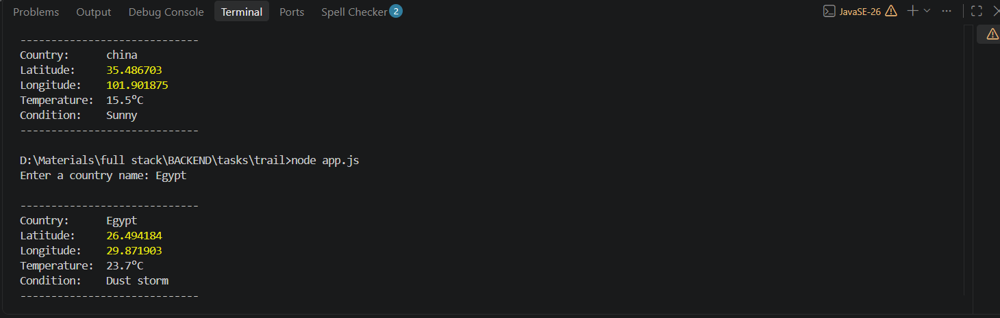
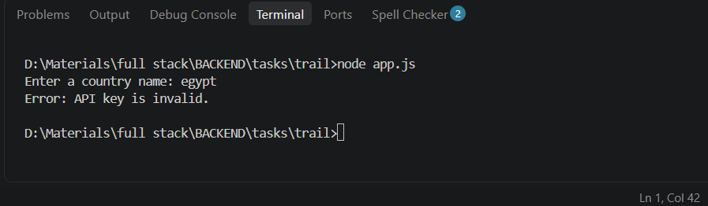
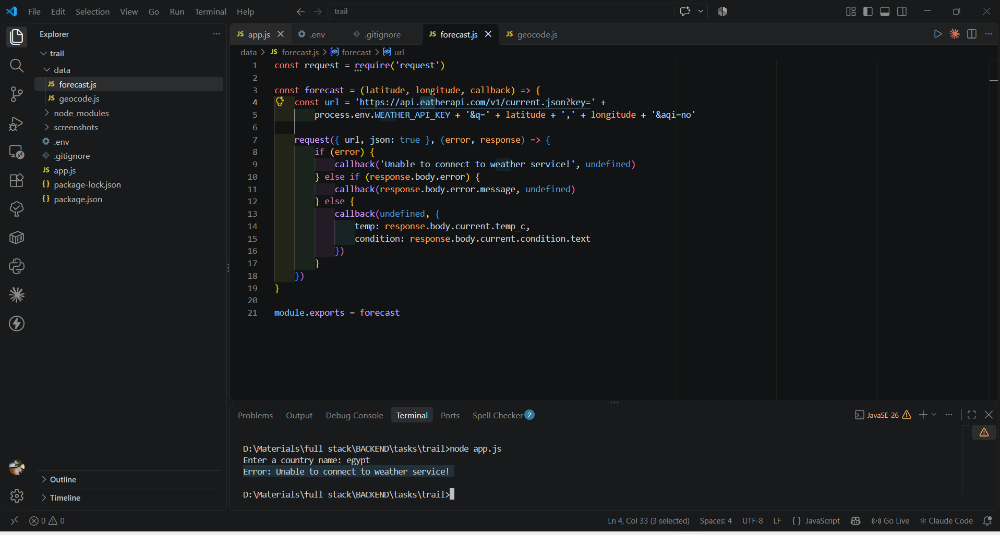
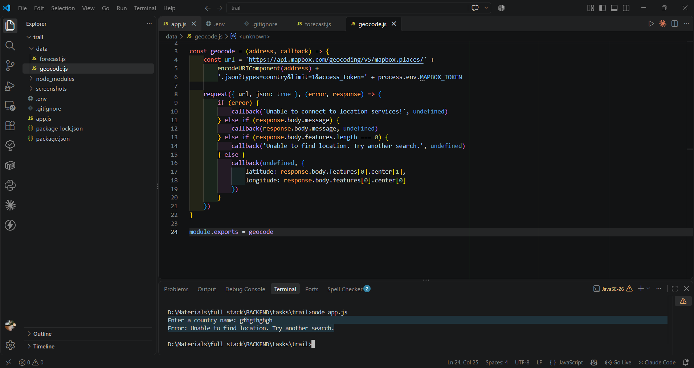

# 🌍 Country Weather CLI

A Node.js command-line app that asks for a country name and displays its
latitude, longitude, and current temperature using the Mapbox Geocoding API
and WeatherAPI.

## ✨ Features

- Prompts for a country name in the terminal
- Converts the country name to coordinates (Mapbox Geocoding API)
- Fetches the current temperature and condition (WeatherAPI)
- Handles errors: invalid API key, country not found, network failures, empty input

## 🛠️ Tech Stack

- Node.js
- [request](https://www.npmjs.com/package/request)
- [dotenv](https://www.npmjs.com/package/dotenv)
- Mapbox Geocoding API, WeatherAPI

## 📦 Installation

```bash
git clone https://github.com/reemwebdev365-ai/country-weather-cli.git
cd country-weather-cli
npm install
```

## 🔑 Configuration

Get a free key from [WeatherAPI](https://www.weatherapi.com/) and a token from
[Mapbox](https://account.mapbox.com/), then create a `.env` file in the project root
(see `.env.example`):

```env
WEATHER_API_KEY=your_weatherapi_key
MAPBOX_TOKEN=your_mapbox_token
```

## ▶️ Usage

```bash
node app.js
```

Then type a country name when prompted.

## 📸 Screenshots

### Successful run


### Invalid API key


### Network error


### Country not found


## ⚠️ Error Handling

| Case | Message |
|------|---------|
| Invalid API key / token | `API key is invalid.` |
| Country not found | `Unable to find location. Try another search.` |
| Network error | `Unable to connect to weather service!` / `Unable to connect to location services!` |
| Empty input | `Please enter a country name.` |

## 📁 Project Structure

```
├── app.js
├── data/
│   ├── geocode.js
│   └── forecast.js
├── screenshots/
├── .env.example
└── .gitignore
```

## 👩‍💻 Author

Reem — [@reemwebdev365-ai](https://github.com/reemwebdev365-ai)